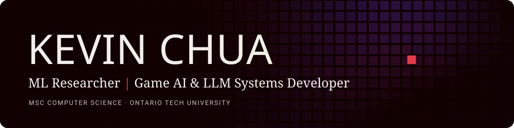

  <a href="https://kevinccme.github.io/about_me/"><b>Portfolio</b></a> &nbsp;·&nbsp;
  <a href="https://kevinccme.github.io/Project_Showcase/"><b>Project showcase</b></a> &nbsp;·&nbsp;
  <a href="https://www.linkedin.com/in/kevincchua/"><b>LinkedIn</b></a> &nbsp;·&nbsp;
  <a href="https://kevinccme.github.io/about_me/resume.pdf"><b>Résumé</b></a>

I build reinforcement-learning agents that playtest games, and methods that keep a language model's persona from drifting over a long conversation. MSc student at Ontario Tech University, supervised by Dr. Cristiano Politowski and Dr. Ali Neshati, and building with AL Shifan at the Code & Sorcery Lab.

### Papers

| 2026 | Paper |
|---|---|
| IEEE CoG | [RIDGE: State-Conditioned Reward Blending for Behavioral Coverage in Deep RL Game Agents](https://arxiv.org/abs/2611.05601) |
| CSER poster | [Trait Activation Steering: Keeping Small-Model NPCs in Character](https://doi.org/10.5281/zenodo.21184301) (first author) |
| CSER poster | [Evolved Neural Agents as Tireless Playtesters](https://github.com/Code-SorceryLab/PEAK-DRL-Tool) |

### Projects

- **[PEAK](https://github.com/Code-SorceryLab/PEAK-DRL-Tool)**: a 2D platformer engine where level authoring and RL training share one loop
- **[Gestura](https://github.com/Al-Scripting/HackHive2026)**: computer vision that lets patients point to where it hurts (HackHive 2026)
- **[LinguaLore](https://github.com/kevinCCme/LinguaLore)**: a mobile app that teaches Klingon, Na'vi and Sindarin
- **[LLM Commander Deck Assistant](https://github.com/kevinCCme/LLM_COMMANDER_DECK_ASSISTANT)**: helps new players build Magic: The Gathering Commander decks
